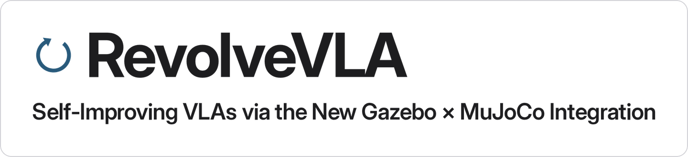
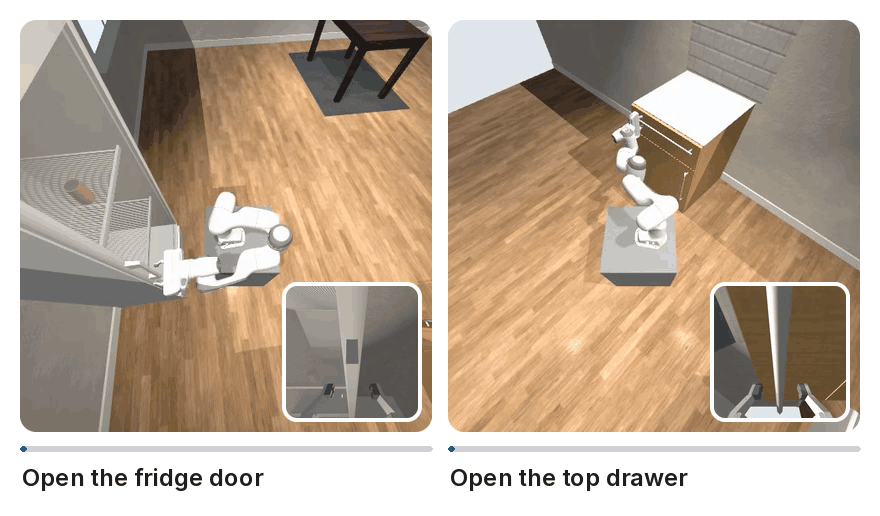
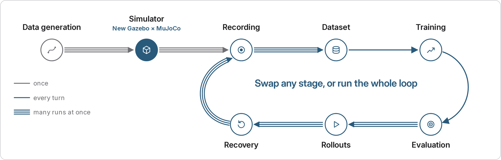
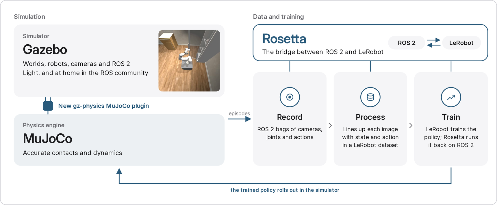
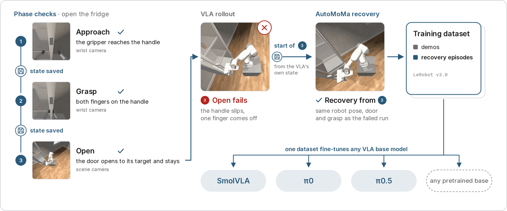
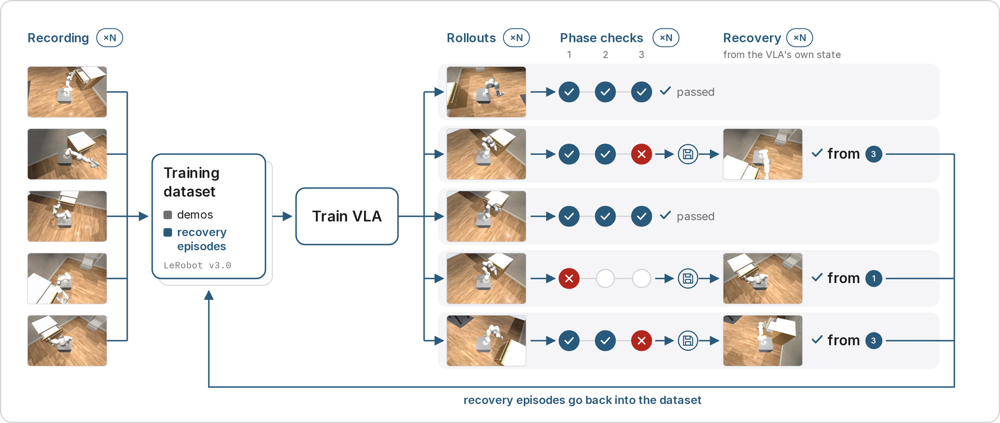
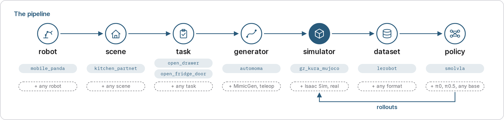

<h1 align="center">
  
</h1>

<p align="center">
An open, plug-and-play architecture for self-improving vision-language-action (VLA) experiments in simulation.
</p>

<p align="center">
  <a href="https://github.com/RevolveVLA/RevolveVLA/actions/workflows/ci.yml"></a>
  <a href="LICENSE"></a>
</p>

<p align="center">
  <a href="docs/assets/teaser/teaser.mp4"></a>
</p>

<p align="center"><em>The mobile Panda opens a fridge door and a drawer in Gazebo with MuJoCo physics. The wrist camera inset turns with the hand. Assets from <a href="https://arxiv.org/abs/2003.08515">PartNet-Mobility</a> and <a href="https://huggingface.co/datasets/ai-habitat/ReplicaCAD_dataset">ReplicaCAD</a>.</em></p>

RevolveVLA trains self-improving VLA robot policies in simulation, over
repeated turns. Gazebo runs the worlds and the robots, and MuJoCo runs
the physics through a new gz-physics plugin. When the policy fails, a
generator such as AutoMoMa makes recovery data from that failure point
for the next turn.

## Why

A VLA that trains only on clean demonstrations does not know what to
do when something goes wrong. On a real robot, it is slow and
expensive to find out how much recovery data helps. RevolveVLA runs
these experiments in simulation, on one stage or on the whole loop.

## The loop

<p align="center">
  
</p>

Turn 0 generates the demonstrations, then trains and evaluates the
policy. Each later turn recovers its failures on probe seeds, merges
that data, retrains the policy and evaluates it on held-out seeds it
never trains on. The loop stops when every held-out seed passes every
phase, or at max_turns. You can swap any stage, or run the whole loop.

## Simulation stack: Gazebo with MuJoCo physics

<p align="center">
  
</p>

- **Gazebo** gives the worlds, the robots, the cameras and the ROS 2
  integration.
- **MuJoCo** gives accurate contacts and dynamics, through the new
  [gz-physics](https://github.com/gazebosim/gz-physics) MuJoCo plugin.
- **[Rosetta](https://github.com/iblnkn/rosetta)** turns the recorded
  ROS 2 bags into LeRobot datasets, and runs the trained policy back in
  the simulator.

## Demonstrations with AutoMoMa

AutoMoMa plans whole-body mobile manipulation demonstrations on NVIDIA
cuRobo. Each demonstration replays in Gazebo and must pass its checks
before it goes into the dataset.

## Learning from failure

<p align="center">
  
</p>

Each task is split into phases, such as approach, grasp and open, and a
live checker watches each phase while the policy acts. The simulator
state is saved at every phase boundary. When a phase fails, AutoMoMa
plans the rest of the task from the state saved before that phase, so
the new data starts where the policy struggles.

## Every stage runs in parallel

<p align="center">
  
</p>

Recording, rollouts, live checks and recovery run as independent
containers, one job per container, and each rollout runs on its own
isolated network. Training has selectable backends: a local GPU, a
remote GPU over SSH, or Modal. The other stages run on the local
machine ([Turns](components/manager/README.md)).

## Every stage is a plugin

<p align="center">
  
</p>

Each stage comes with a default plugin, and you can plug in your own.
The robot, scene and task are spec folders, in `specs/robots`,
`specs/scenes` and `specs/tasks`. The generator, simulator, dataset and
policy are components, each in `components/<name>/` with its own Docker
image. The rest of the loop stays the same.

## Quickstart

TBD

## Citation

If you use RevolveVLA in your research, please cite it:

```bibtex
@misc{revolvevla2026,
  title  = {{RevolveVLA}: Self-Improving {VLAs} via the New {Gazebo} x {MuJoCo} Integration},
  author = {Shinde, Soham and Saravanan, Suchetan and Amal Darren, Kevin},
  year   = {2026},
  howpublished = {\url{https://github.com/RevolveVLA/RevolveVLA}}
}
```

## Acknowledgements

RevolveVLA builds on these projects:

- [Rosetta](https://github.com/iblnkn/rosetta) converts the bags to
  LeRobot datasets and runs the policy on ROS 2.
- [LeRobot](https://github.com/huggingface/lerobot) defines the dataset
  format and trains the policy, such as
  [SmolVLA](https://huggingface.co/lerobot/smolvla_base).
- [AutoMoMa](https://github.com/fi6/automoma) plans the whole-body
  trajectories on NVIDIA [cuRobo](https://github.com/NVlabs/curobo).
- [Gazebo](https://gazebosim.org) Kura runs the simulation, with
  [MuJoCo](https://github.com/google-deepmind/mujoco) physics through
  the [gz-physics](https://github.com/gazebosim/gz-physics) MuJoCo
  plugin.
- PartNet-Mobility ([SAPIEN](https://arxiv.org/abs/2003.08515)) gives
  the fridge and the cabinet,
  [ReplicaCAD](https://huggingface.co/datasets/ai-habitat/ReplicaCAD_dataset)
  the table, [ambientCG](https://ambientcg.com) the room textures, and
  [`franka_description`](https://github.com/frankarobotics/franka_description)
  the Panda model.

## Licence

The code is under the [Apache License 2.0](LICENSE).
